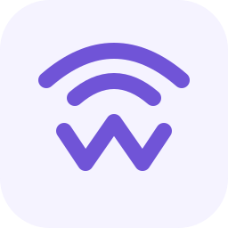
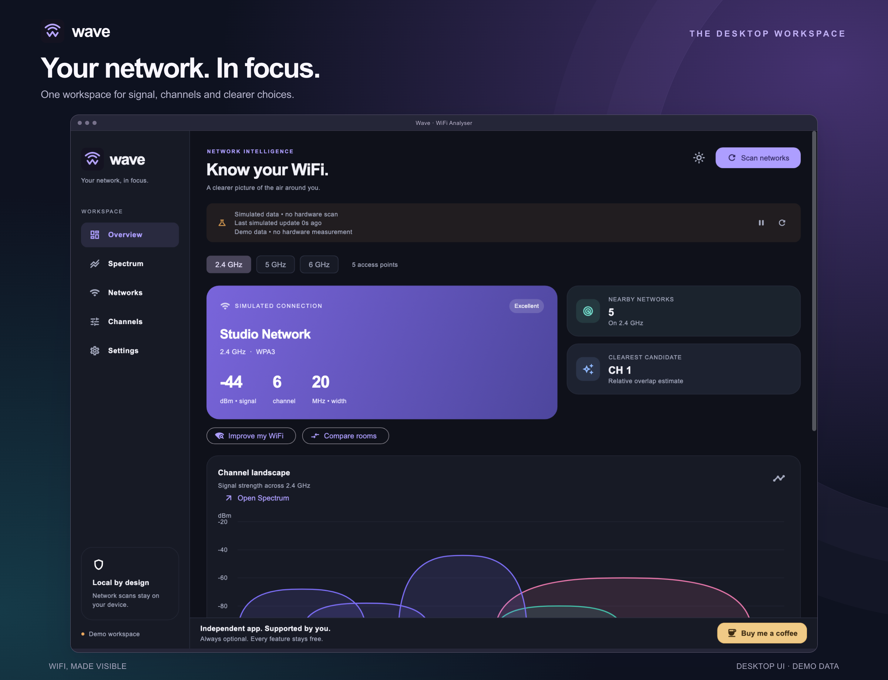
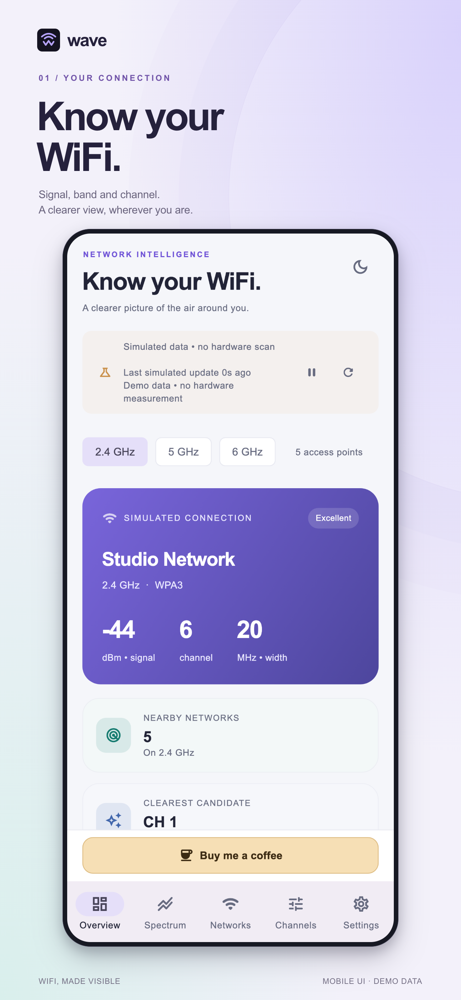
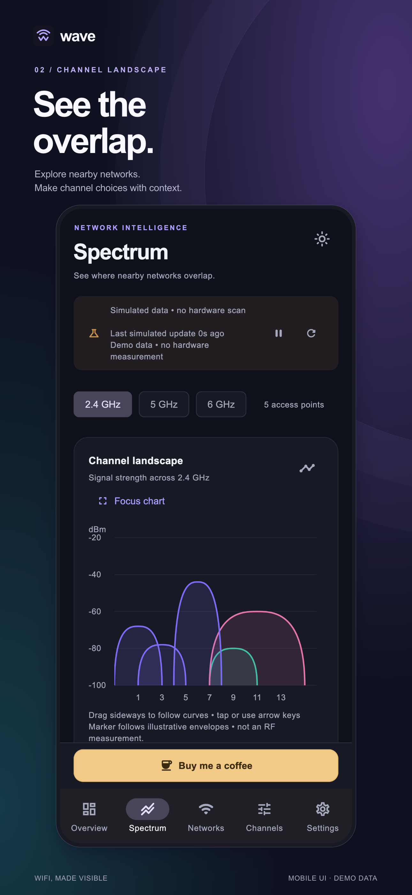
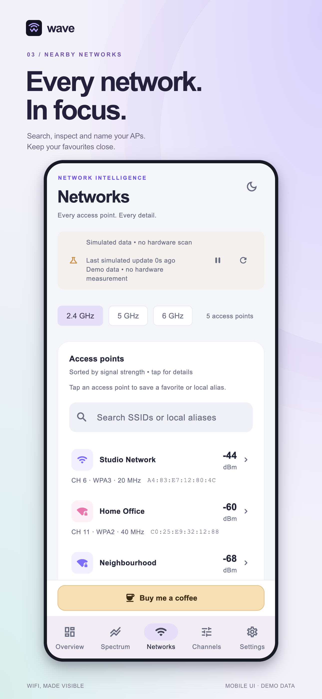
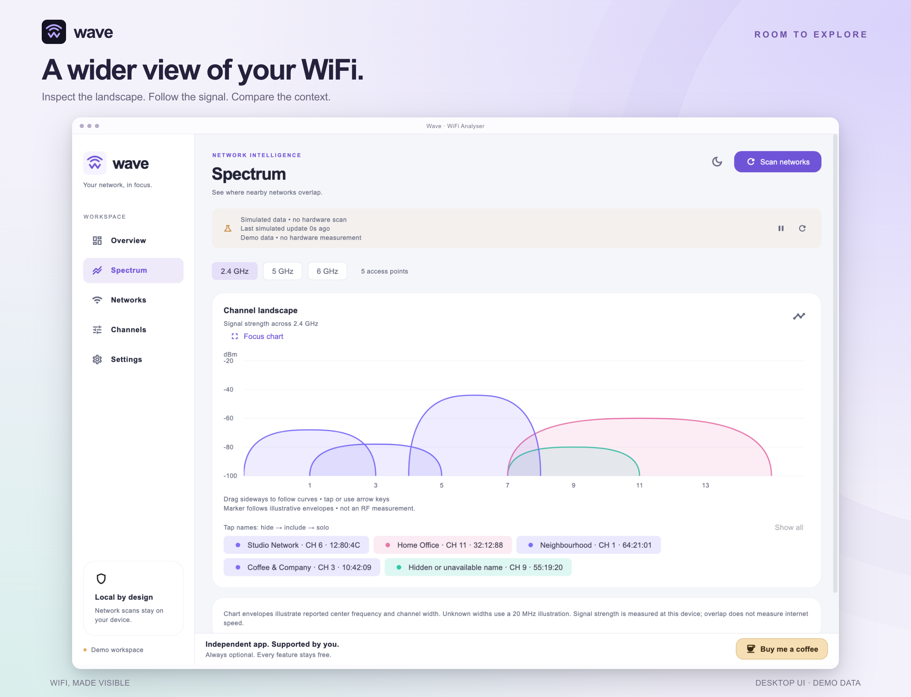

<div align="center">
  
  <h1>Wave · WiFi Analyser</h1>
  <p><strong>WiFi, made visible.</strong></p>
  <p>Understand your signal. Explore channel overlap. Compare your rooms.</p>
  <p>Phone and desktop · Light and dark themes · All features free</p>
</div>

Wave is a Flutter WiFi analyser with a shared interface across mobile and desktop.
See nearby networks, inspect your connection and keep comparisons on your device.
No account is required. Optional support never unlocks or restricts a feature.

> [!CAUTION]
> **Windows and Linux are experimental and have not been tested on real desktop WiFi hardware.**
> Windows compilation and runtime are still unverified. Linux x64 has been built
> on Ubuntu 24.04 and passed automated/headless checks, but real-world WiFi scans,
> permissions and everyday desktop operation remain untested. Do not treat these
> ports as production-verified. See [Windows evidence](docs/WINDOWS.md) and
> [Linux evidence](docs/LINUX.md) before relying on either platform.



## A clearer view, on every screen

<p align="center">
  
  
  
</p>

These store-style images frame **real renders of the shared Flutter interface**.
All displayed networks are explicitly labelled demo data. Captures do not imply
Windows/Linux hardware testing, iOS live scanning or App Store/Play Store availability.
[Original captures and reproduction steps](docs/screenshots/README.md).

## Supported platforms

| Platform | WiFi scanning | Current verification | Export |
| --- | --- | --- | --- |
| **Android** | Native live scans with `WifiManager` | Physical Android checks recorded, including 2.4/5 GHz; remaining cases documented | System file sharing |
| **macOS** | Native live scans with CoreWLAN | Real Mac scanning, comparisons, export cancellation and persistence checks recorded | System file sharing |
| **Windows** | Native WLAN bridge implemented; live mode by default | **Not tested on real Windows devices. Native compilation/runtime unverified.** Experimental | Windows sharing implemented; unverified |
| **Linux** | NetworkManager + nl80211 live bridge; real kernel dBm | **Not tested on real Linux WiFi hardware.** Ubuntu 24.04 x64 build and headless tests passed. Experimental | Save reviewed summary + CSV to a chosen folder |
| **iOS** | **Demo only**; no live nearby-WiFi bridge | Shared mobile UI; live scanning not implemented | Shared export flow; verify on target device |
| **Web** | **Demo only**; no browser WiFi scanning | Web release build checked | Browser-dependent file sharing |

Live scanning needs supported hardware and platform authorization. Android requires
precise location permission and Location services; macOS requires Location access
for network identifiers. Recent Windows versions also gate WiFi APIs on Location
consent. Linux requires NetworkManager, a managed adapter, nl80211 dBm support and
an authorized desktop session. The current Linux bundle targets **Ubuntu 24.04 x64**
and its modern glibc/libstdc++ runtime; Ubuntu 22.04 is not compatible with the
bundled prebuilt Rive runtime.

Demo mode is available explicitly on every target. A failed live scan **never
silently switches to simulated networks**. Full setup and limitations:
[Android verification](docs/FRESHNESS_AND_GUIDANCE.md) ·
[macOS](docs/MACOS_SCANNING.md) · [Windows](docs/WINDOWS.md) · [Linux](docs/LINUX.md).

## What you can do

| Workspace | Features |
| --- | --- |
| **Overview** | Connected-network card, RSSI/quality, band/channel, available security/width, nearby counts and channel insights. Guided **Improve my WiFi** baseline/recheck for the same AP. |
| **Spectrum** | Illustrative channel landscapes, accepted signal history, focus view, hide/include/solo legends and pointer/touch/keyboard inspection. Explore 2.4, 5 and 6 GHz. |
| **Networks** | Search SSID, BSSID or local alias; sort by signal; inspect AP details; copy MAC addresses; save favourites and aliases, including identities not currently seen. |
| **Channels** | Explainable overlap rankings, connected-AP exclusion, desired channel widths, manual channel shortlists and per-candidate contributors. |
| **Compare rooms** | Foreground recordings for one BSSID, optional room labels, saved sessions, separate radio contexts, medians/ranges and visible observation gaps. |
| **Private export** | Review summary and CSV before sharing/saving. Network identifiers and room labels are excluded by default, with separate opt-ins. Aliases are never exported. |
| **Scanning controls** | Manual scan, automatic foreground requests, pause/resume, scan age, cached/stale/pending feedback and platform recovery actions. |
| **Appearance** | Persistent system/light/dark themes, responsive phone/desktop layouts, violet-to-indigo connection card, shared Wave icons and finite motion. |
| **Accessibility** | Large-text reflow, reduced-motion support, keyboard focus, desktop Cmd/Ctrl+1–5 navigation, Cmd/Ctrl+R scan and Escape return from supported views. |
| **Welcome & settings** | Three original Rive scenes with replay/skip, saved welcome completion, theme/signal preferences and separate storage-error feedback. |

Data tabs follow the connected AP's band until you make a manual selection.
Android and desktop foreground requests run every **35 seconds**, subject to OS,
driver and authorization limits. Demo updates every **3 seconds**. Pausing or
backgrounding stops automatic work; late replies cannot add unrelated history.

[Detailed feature reference](docs/FEATURES.md) · [Roadmap](docs/ROADMAP.md)



## Honest measurements, useful context

- Android history requires accepted new radio timestamps. Desktop history uses
  distinct accepted scan completions; this does **not** prove every AP was observed
  anew. Cached/duplicate updates add no samples. Age and source remain visible.
- Unknown RF fields stay unknown. Windows/Linux do not report channel width or
  center frequency through these bridges; charts and overlap scoring disclose a
  **20 MHz assumption** for unknown widths.
- Chart envelopes illustrate signal/channel context. Channel rankings are local
  overlap heuristics, not measurements of noise, traffic, throughput or guaranteed
  improvement. Distance is an approximate free-space estimate and can be inaccurate
  indoors. A visible 6 GHz tab does not establish 6 GHz hardware verification.
- Wave does not run speed tests, discover every device on your LAN, configure your
  router, capture packets, build GPS heatmaps or offer cloud/AI diagnostics.

## Privacy and optional support

WiFi identifiers, aliases, preferences and saved comparisons stay on your device.
Wave does not collect location coordinates. Export is an explicit action after
preview; timing and radio context can still identify a place, even when names are
excluded. Receiving apps may retain shared copies. Linux saves into a new export
subfolder without overwriting existing files.

Scanning and saved data do not require a Wave account or cloud service.
**Shorebird-enabled releases** contact Shorebird for update/version and installation
metadata; WiFi observations are not supplied to the updater. Ordinary Flutter builds
do not contain its update engine. See [update setup and privacy](docs/SHOREBIRD.md).

The persistent warm amber **Buy me a coffee** action opens
[buymeacoffee.com/samirpandey](https://buymeacoffee.com/samirpandey).
Support is entirely optional. **Every feature stays free.**

## Run from source

Flutter **3.47.5** is pinned through [FVM](https://fvm.app/) in `.fvmrc`.
Use the host platform's native toolchain for desktop builds.

```sh
fvm install
fvm use
fvm flutter pub get
fvm flutter devices
fvm flutter run -d <device-id>
```

Common targets:

```sh
fvm flutter run -d macos
fvm flutter run -d windows   # Windows host + Visual Studio C++ required
fvm flutter run -d linux     # Supported Linux host/toolchain required
fvm flutter run -d chrome    # Explicitly labelled demo UI
```

Android: select a device/emulator ID from `flutter devices`. iOS: build on macOS
with Xcode and select an iPhone device/simulator; nearby WiFi remains demo only.
Rive and native dependencies may download during setup. Do not change the SDK pin
or substitute invented Shorebird IDs to get a build to pass.

## Build, package and verify

```sh
ai/scripts/check.sh
fvm flutter build apk --debug
fvm flutter build macos --debug
fvm flutter build web --release
```

| Target | Native setup and packaging |
| --- | --- |
| Windows | `./tool/windows/validate.ps1` in PowerShell 7; complete Release ZIP. [Guide](docs/WINDOWS.md) |
| Linux | `FLUTTER_BIN="$PWD/.fvm/flutter_sdk/bin/flutter" ./tool/linux/validate.sh`; complete x64 tar bundle. [Guide](docs/LINUX.md) |
| Android / macOS updates | Pinned Shorebird builds, stable app ID and signing requirements. [Guide](docs/SHOREBIRD.md) |

Manual [Windows](.github/workflows/windows.yml) and
[Linux](.github/workflows/linux.yml) GitHub Actions workflows prepare build artifacts;
they do not publish app-store releases. Never distribute a desktop executable alone:
its bundled libraries and assets are required.

Current development evidence includes **231 Flutter tests**, native Linux protocol/
normalization tests, Linux release compilation and a headless Linux desktop bridge/
navigation smoke test. Android, macOS and web builds have passed. These automated
checks do not replace real Windows/Linux WiFi testing. Android/macOS development
signing and production distribution requirements remain documented separately.
Windows Shorebird production distribution is held for the documented engine-version
constraint; the existing 3.47.5 pin remains unchanged.

## Project structure

Wave uses **Flutter + MVVM + Riverpod**, with injectable native/storage boundaries.

- `lib/models/` — immutable WiFi state, channels, comparisons and export logic.
- `lib/repositories/` — native channels, local storage, explicit demo and export/support boundaries.
- `lib/viewmodels/` — scan lifecycle, preferences, guidance and recordings.
- `lib/views/`, `lib/widgets/` — responsive pages, charts and shared interaction components.
- `android/`, `macos/`, `windows/`, `linux/` — native scanning implementations.
- `test/`, `integration_test/` — behavioural, rendering and native checks.

[Agent guide](AGENTS.md) · [Architecture rules](ai/rules/flutter-architecture.md) ·
[Branding source](assets/branding/README.md) · [Rive artwork](docs/RIVE_ONBOARDING.md) ·
[Motion evidence](docs/MOTION_VERIFICATION.md) · [Comparison evidence](docs/SAVED_COMPARISON_SESSIONS.md)
